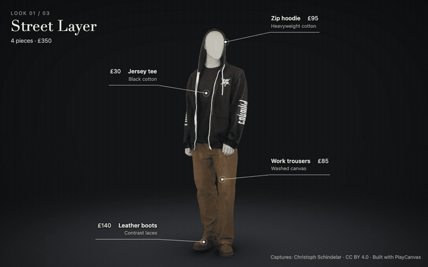

# The Future of Clothes Shopping

Three real outfits, captured as Gaussian splats, on one figure in your browser. The figure
breathes and shifts its weight, its head follows your camera, every piece is labelled, and one
outfit morphs into the next.

**[Open the live demo](https://willeastcott.github.io/fashion-splat-demo/)**



Built with the [PlayCanvas](https://playcanvas.com) engine. The captures are by
[Christoph Schindelar](https://superspl.at/user/schindelar3d).

## What to try

- **Leave it alone.** Until you touch it, the demo runs itself: the camera drifts, each piece is
  picked out in turn, and the outfit changes.
- **Pick an outfit** with the buttons at the bottom.
- **Drag to orbit, scroll or pinch to zoom.** The head turns to follow you, and labels move to
  whichever side of the body their piece is on. Orbit behind for the back of each outfit.
- **Hover or tap a label** to light up that piece.
- **Open Controls** (bottom left, desktop only) for the idle strength, a view of the rig's bone
  weights, and presentation mode.
- **Press P** for presentation mode: the same self-running show with the controls and pointer
  hidden, for recording.

| Add to the address | Effect |
|---|---|
| `?detail=lite` / `standard` / `full` | 500k, 1M or about 2.9M gaussians per outfit. Phones get `lite` by default, everything else `standard`. |
| `?device=webgl2` | Use WebGL2 instead of WebGPU. |
| `?present` | Start in presentation mode. |

It runs best where WebGPU is available (recent Chrome, Edge and Safari) and falls back to
WebGL2 elsewhere.

## How it works

**A rig with no mesh.** A splat has no vertices to attach skin weights to, so the weights are a
pure function of where each gaussian sits: a vertical chain (pelvis, spine, chest, head) blended
by height, and two legs separated by a plane between them. Nine rigid bones are applied in the
engine's splat shader hooks. Arms take the torso's weights at the same height, so they never
separate from the body and the shading baked into the capture stays believable. The idle is
procedural: weight shifting over planted feet, breathing, and a head that turns towards the
camera. See [`src/rig-shader.js`](src/rig-shader.js) and [`src/rig.js`](src/rig.js).

**A morph between captures that share nothing.** The three outfits are separate scans of
different mannequins, so there is no real correspondence between their gaussians. One is
manufactured offline: each figure is cut into blocks about 10 cm tall between its own landmarks,
and inside a block gaussians are ordered by height, then angle around the body, then distance
from its centre. Pairing by rank puts partners a median of 7 cm apart. All three outfits are
stored in that one shared order, so a morph is a per-gaussian blend. See
[`tools/build-morph.mjs`](tools/build-morph.mjs).

**Two waves and a band of dots.** The morph runs as two waves crossing the body on a diagonal.
The first draws the cloth in to small round dots; between the waves each dot glides to its
partner; the second opens the dots out into the new cloth. The dots stay crisp where blended
cloth would smear. See [`src/morph.js`](src/morph.js).

**Labels that ride the body.** Each callout is a point on a garment. It goes through the same
skinning as the gaussians, on the CPU, so it stays on its spot as the body moves. During a morph
it travels to its counterpart on the next outfit and changes its text as the wave passes. See
[`src/callouts.js`](src/callouts.js).

**A small download.** Each outfit is packed to about 11 bytes per gaussian: 33 MB for all three
at the standard detail, 16 MB on phones. Rotation, scale, colour and opacity come back
bit-identical to what the GPU textures hold; positions are rounded to 0.1 mm. The first outfit
is shown as soon as it arrives. See [`src/pack.js`](src/pack.js).

The studio floor, contact shadows, bloom and the light the morph throws on the floor are in
[`src/stage.js`](src/stage.js). The shadows are soft shapes drawn at the rig's ankles, not cast
by the splats.

## Run it locally

```bash
npm install
```

```bash
npm run dev
```

The outfit data is in the repository (`public/morph-*`), so that is all it needs. `npm run build`
writes a static site to `dist`. Pushing to `main` builds and publishes it to GitHub Pages.

## Rebuilding the outfit data

Only needed if you change the pairing, the rig landmarks in [`src/figures.js`](src/figures.js),
or the pack format.

1. Download the three captures as PLY from SuperSplat:
   [Casual_01](https://superspl.at/scene/c297db17),
   [Casual_02](https://superspl.at/scene/60c01999) and
   [Outdoor_01](https://superspl.at/scene/3ccba00a).
2. Unpack them to `raw/Casual_01/scene.ply`, `raw/Casual_02/scene.ply` and
   `raw/Outdoor_01/scene.ply`.
3. Run `npm run data`. It decimates each capture, pairs the gaussians and writes the three packs.

`node tools/anchor.mjs <figure> front <x> <y>` prints a point on an outfit's surface, for
placing a new callout in `src/figures.js`.

## Credits and licence

- **Captures:** Casual_01, Casual_02 and Outdoor_01 by
  [Christoph Schindelar](https://superspl.at/user/schindelar3d), licensed under
  [CC BY 4.0](https://creativecommons.org/licenses/by/4.0/). The data in `public/morph-*` is
  adapted from them: cropped to the figure, scaled and turned into a common frame, decimated for
  the lighter packs, re-ordered, and stored without view-dependent colour. It carries the same
  licence and the same credit.
- **Engine:** [PlayCanvas](https://github.com/playcanvas/engine), MIT.
- **Product names and prices** are invented for the demo. They do not describe the real garments.
- **Code:** no licence has been chosen for the code in this repository yet.
